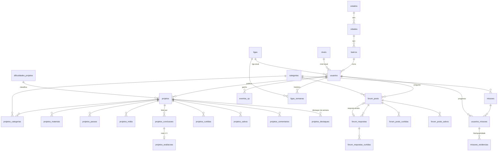

# Modelo de dados do ARIC

Schema `aric` no PostgreSQL. O banco nasce de `script.sql` + inserts + `003_schema_completo.sql`
+ `004_projetos_moderacao.sql` + `005_missoes_evidencias.sql` (veja a ordem no README). Este documento explica o que cada parte faz e as regras que o backend
precisa seguir.

## Visão geral



## Das telas para as tabelas

| Tela | O que aparece | Onde está |
|------|---------------|-----------|
| Home | Impacto do bairro ("184 kg") | soma de `projetos.residuos_kg` das `projetos_conclusoes` de hoje dos moradores do bairro (rota `GET /gamificacao/impacto-bairro`) |
| Home | Busca e chips de categoria | `projetos.busca` (full-text em português) e `categorias` (`tipo`, `cor`) |
| Home | Destaque da semana | `projetos_destaques` |
| Home | Criações da vizinhança | `projetos` com `autor_id` de usuários do mesmo bairro/cidade |
| Projeto | Galeria, materiais, passo a passo | `projetos_midia` (`ordem` 1 = capa), `projetos_materiais`, `projetos_passos` |
| Projeto | "1,2 mil pessoas já fizeram", curtidas, comentários, salvar | `projetos_conclusoes`, `projetos_curtidas`, `projetos_comentarios`, `projetos_salvos` |
| Fórum | Perguntar / Dúvidas abertas / Dicas rápidas | `forum_posts.tipo` (`duvida` ou `dica`) |
| Fórum | Em aberto / Resolvido | resolvido = `resposta_aceita_id` preenchida |
| Fórum | Curtidas, respostas, salvar, busca | `forum_posts_curtidas`, `forum_respostas`, `forum_posts_salvos`, `forum_posts.busca` |
| Todas (topo) | Pontos ao lado da foto | `usuarios.xp_total` |
| Comunidade | Ranking da liga na semana, tendência, "Sua posição" | função `aric.ranking_liga(liga_id)` |
| Comunidade | Fechamento de segunda (quem sobe/desce) | `ligas`, `usuarios.liga_id`, `ligas_semanas`, função `aric.fechar_semana_ligas(...)` |
| Missões | Nível, XP, barra até o próximo nível | `usuarios.xp_total`, `usuarios.nivel_id`, `niveis.minimo_xp` |
| Missões | Missões da semana com progresso | `missoes`, `usuarios_missoes`, `missoes_evidencias` |
| Perfil | Posição (no lugar de "#14 no Bairro") | posição do usuário em `aric.ranking_liga(...)`, ex.: "#14 na Liga Broto" |
| Perfil | Sequência ativa | `usuarios.sequencia_dias` + `usuarios.ultima_atividade_em` |
| Perfil | Resíduos reutilizados, vidas inspiradas | soma de `residuos_kg` das conclusões do usuário; pessoas diferentes que concluíram projetos dele |

## Decisões de produto

- **Ranking:** só por ligas semanais. A tela Comunidade mostra a liga do usuário, e não há abas
  Bairro/Cidade/Mensal.
- **EcoPontos e XP são a mesma coisa.** "EcoPontos" é só o nome que aparece na tela. Não existe
  saldo para gastar.
- **Clube de Benefícios:** fora do escopo por enquanto. Sai da tela de Missões.
- **Topo das telas:** mostra o XP total (`usuarios.xp_total`).
- **CO₂ poupado:** removido do Perfil.

## Regras que o backend precisa seguir

### XP

- **Todo XP entra por `eventos_xp`.** Nunca altere `usuarios.xp_total` direto: um trigger já soma
  o XP, recalcula `nivel_id` e atualiza a sequência de dias a cada evento inserido.
- **Insira o evento na mesma transação da ação.** Exemplo, ao concluir um projeto:
  `INSERT projetos_conclusoes` + `INSERT eventos_xp (origem 'projeto_concluido', referencia_id = projeto)`
  dentro do mesmo `BEGIN/COMMIT`.
- **Não dá para ganhar XP duas vezes pela mesma coisa:** `(usuario_id, origem, referencia_id)` é único.
  Se o INSERT der erro `23505`, a ação já tinha sido recompensada.
- **Correção é com evento `ajuste`** (positivo ou negativo). `UPDATE` em `eventos_xp` é bloqueado.
- **O XP do projeto vem da dificuldade** (`dificuldades_projetos.xp_padrao`), copiado para
  `projetos.xp` ao publicar. O autor não escolhe quanto o projeto vale.
- **Sequência de dias:** só eventos positivos que não sejam `ajuste` contam. Ao exibir, mostre 0
  se `ultima_atividade_em < hoje - 1` (o trigger só zera quando o usuário volta a agir).

### Semanas

- **A semana começa na segunda-feira, no horário de São Paulo.** Use `aric.inicio_semana(now())`
  para obter a segunda da semana atual.

### Ligas

- **Usuário novo entra na liga mais baixa** automaticamente (trigger).
- **A API fecha a semana sozinha** (verifica de hora em hora; `LIGAS_JOB=off` desliga). Pelo cron,
  o comando é:
  ```sql
  SELECT aric.fechar_semana_ligas(aric.inicio_semana(now()) - 7);
  ```
  Ela grava o resultado em `ligas_semanas` e move `usuarios.liga_id`. Recusa semana em andamento
  e semana já fechada, então rodar duas vezes não estraga nada.
- **Quem sobe e quem desce:**
  - Sobem os `qtd_sobe` primeiros da liga, desde que tenham feito XP na semana.
  - Descem os `qtd_desce` últimos, menos quem está na zona de subida (em liga pequena, ninguém
    sobe e desce ao mesmo tempo).
  - Empate: quem se cadastrou antes fica na frente.

### Fórum

- **Sem revisão prévia:** posts e respostas aparecem na hora. Moderadores podem apagar.
- **A resposta aceita precisa ser do próprio post:** isso é garantido por FK composta.
- **Dica não tem resposta aceita** (CHECK).
- **Aceite:** só o autor da dúvida aceita, e não pode aceitar a própria resposta. Quem respondeu
  ganha 50 XP (`forum_resposta_aceita`), uma vez por resposta.
- **Missões:** dúvida nova avança "perguntar_forum". Responder o post de outra pessoa avança
  "responder_forum".
- **Apague com soft delete** (`deletado_em`). Apagar a resposta aceita volta a dúvida para "em
  aberto".

### Projetos

- **Só avalia quem fez o projeto:** `projetos_avaliacoes` tem FK para `projetos_conclusoes`.
- **`autor_id` NULL** significa projeto oficial do ARIC.
- **`status`:**
  - `rascunho`: o autor ainda está montando.
  - `em_revisao`: é o padrão; o projeto aguarda um moderador.
  - `publicado`: aprovado e visível para todos.
  - `oculto`: rejeitado ou tirado do ar, com `motivo_moderacao`.
  - `removido`: apagado.
- **Listagens públicas** filtram por `status = 'publicado'`.
- **Editar um projeto publicado** faz ele voltar para `em_revisao`.
- **XP de publicação:** na primeira aprovação (`publicado_em` vazio), o autor ganha 100 XP
  (`projeto_publicado`).

### Missões

- **Toda missão ativa vale para todas as semanas.** O progresso é por usuário e semana
  (`usuarios_missoes.semana_inicio`), então zera sozinho na segunda.
- **`acao` diz o que faz o progresso andar:**
  - `concluir_projeto`, `publicar_projeto`, `responder_forum` e `perguntar_forum`: o backend
    incrementa o progresso ao tratar essas ações, filtrando por `categoria_id` quando a missão tem
    categoria.
  - `registro_manual`: o usuário envia foto e quantidade em `missoes_evidencias`, e um moderador
    (`usuarios.papel`) aprova ou rejeita com `motivo_rejeicao`. A quantidade aprovada soma no
    progresso da semana em que a foto foi enviada.
- **Ao atingir a meta:** preencha `concluida_em` e insira o evento
  `missao_concluida` com `referencia_id = usuarios_missoes.id`.

## Consultas prontas

Ranking da aba **Comunidade** (liga do usuário, semana atual):

```sql
SELECT * FROM aric.ranking_liga((SELECT liga_id FROM aric.usuarios WHERE id = $1));
-- "Sua posição": mesma chamada com WHERE usuario_id = $1
```

Colunas devolvidas:
- `posicao`: posição na liga.
- `xp_semana`: XP desde segunda.
- `tendencia`: posições ganhas (+) ou perdidas (-) desde o fim de ontem; é a seta da tela.
- `zona`: `sobe`, `desce` ou `mantem`, se a semana fechasse agora. Serve para pintar a linha de
  corte.

**Impacto do bairro hoje** (Home):

```sql
SELECT COALESCE(SUM(p.residuos_kg), 0) AS kg_hoje
FROM aric.projetos_conclusoes pc
JOIN aric.projetos p ON p.id = pc.projeto_id
JOIN aric.usuarios u ON u.id = pc.usuario_id
WHERE u.bairro_id = $1
  AND pc.data_conclusao >= (now() AT TIME ZONE 'America/Sao_Paulo')::date;
```

**Busca de projetos**:

```sql
SELECT p.*, ts_rank(p.busca, q) AS relevancia
FROM aric.projetos p, plainto_tsquery('portuguese', $1) q
WHERE p.status = 'publicado' AND p.busca @@ q
ORDER BY relevancia DESC;
```

**Fórum "Mais votadas"**:

```sql
SELECT f.id, f.titulo, f.tipo, (f.resposta_aceita_id IS NOT NULL) AS resolvido,
       u.nome AS autor, b.nome AS bairro, c.nome AS categoria,
       (SELECT count(*) FROM aric.forum_posts_curtidas fc WHERE fc.post_id = f.id) AS curtidas,
       (SELECT count(*) FROM aric.forum_respostas r
         WHERE r.post_id = f.id AND r.deletado_em IS NULL) AS respostas
FROM aric.forum_posts f
JOIN aric.usuarios u ON u.id = f.autor_id
JOIN aric.bairros b ON b.id = u.bairro_id
LEFT JOIN aric.categorias c ON c.id = f.categoria_id
WHERE f.deletado_em IS NULL
ORDER BY curtidas DESC, f.criado_em DESC
LIMIT 20;
```

**Missões da semana do usuário**:

```sql
SELECT m.id, m.titulo, m.xp, m.meta, m.unidade, c.nome AS categoria,
       COALESCE(um.progresso, 0) AS progresso,
       LEAST(100, COALESCE(um.progresso, 0) * 100 / m.meta) AS percentual,
       um.concluida_em
FROM aric.missoes m
LEFT JOIN aric.categorias c ON c.id = m.categoria_id
LEFT JOIN aric.usuarios_missoes um
       ON um.missao_id = m.id AND um.usuario_id = $1
      AND um.semana_inicio = aric.inicio_semana(now())
WHERE m.ativa
ORDER BY m.id;
```

Os contadores (curtidas, respostas, "pessoas que fizeram") são calculados com `count(*)` sobre
tabelas indexadas. No volume de um MVP isso é rápido. Se ficar lento, dá para virar colunas de
contador atualizadas por trigger.
